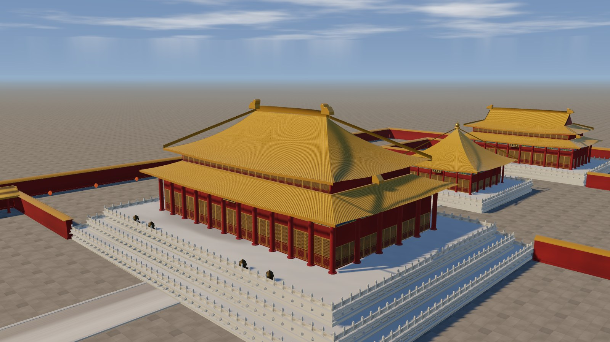
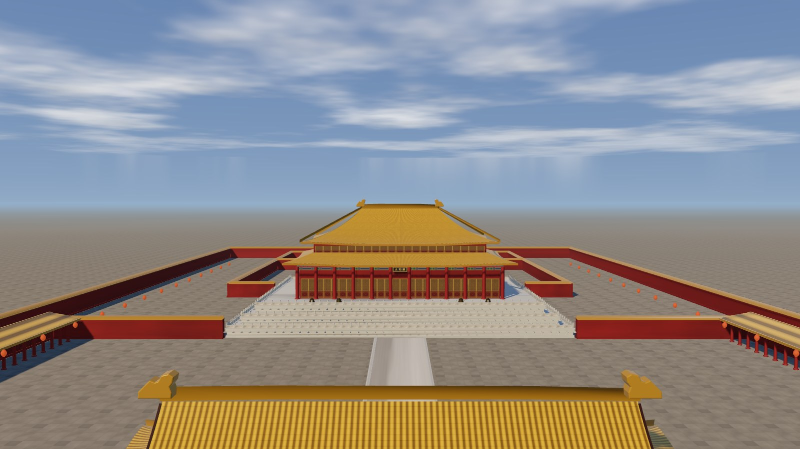
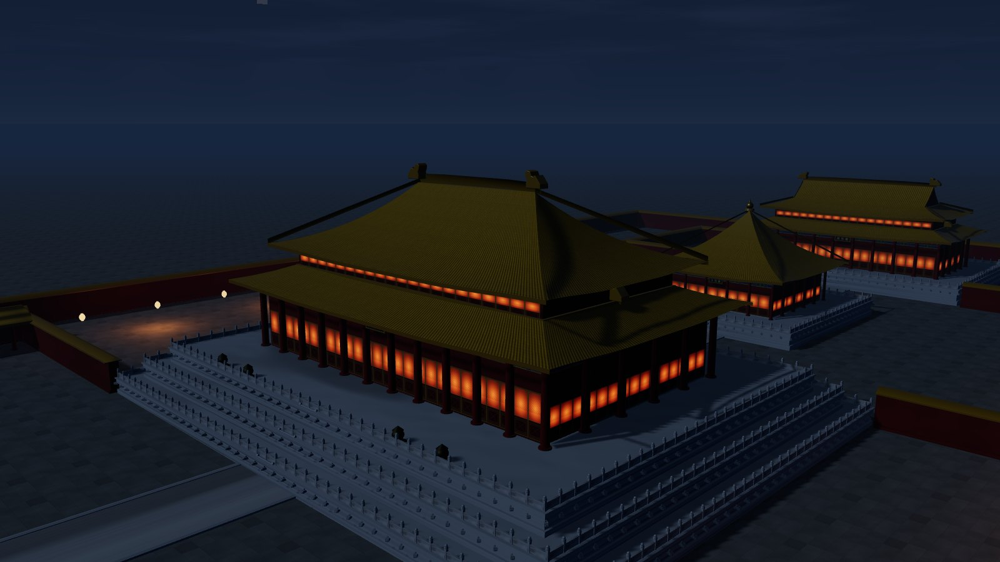
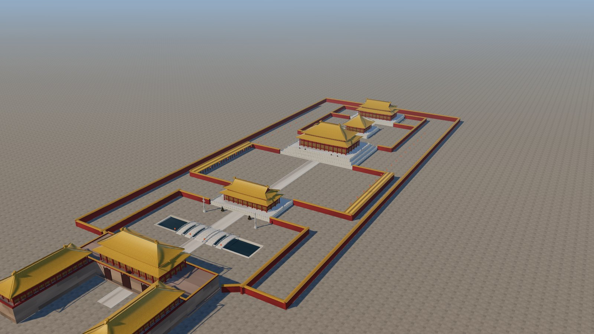
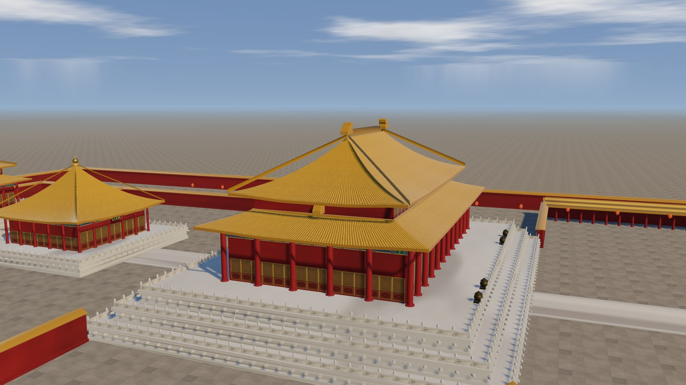
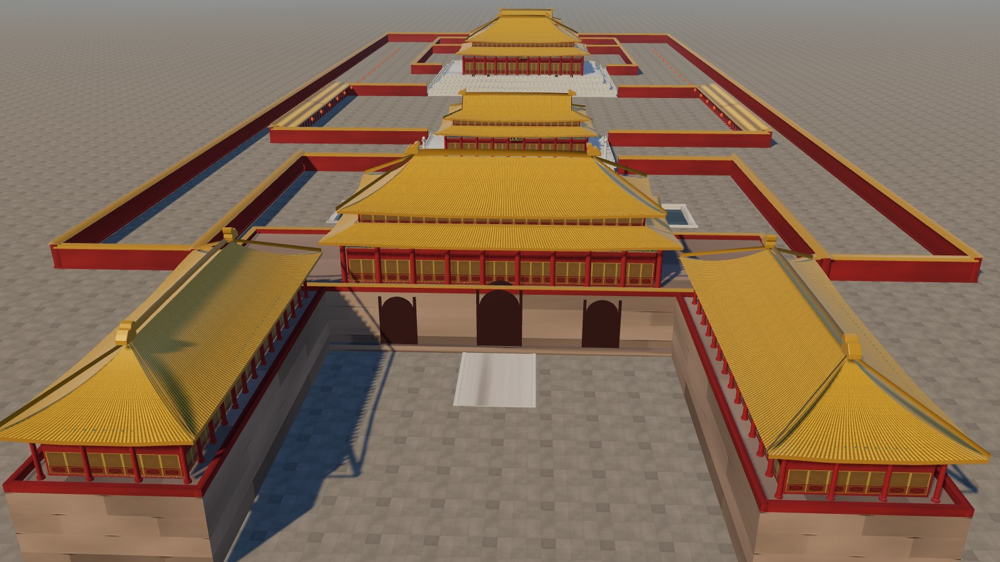
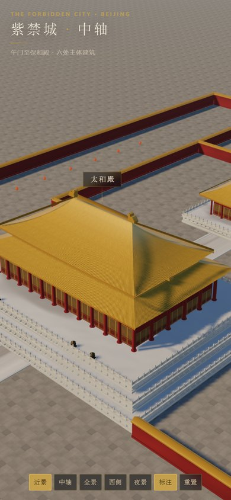

# 紫禁城 · 中轴 — Forbidden City in 3D

**不用任何建模软件，不用任何位图贴图。** 午门到保和殿的六处主体建筑，
其几何与纹理全部在浏览器里由代码实时生成。



<p align="center"><em>太和殿 · 重檐庑殿 · 三层汉白玉台基</em></p>

---

## 跑起来

**Windows 下直接双击 `start.cmd`** —— 它会起一个本地服务器并打开浏览器。

其它平台或手动启动：

```bash
cd forbidden-city-3d
python -m http.server 8080      # 或 npx serve . / node tools/serve.mjs . 8080
```

然后打开 <http://127.0.0.1:8080/>。

> **不能双击 `index.html`。**
> 本项目是 ES Module，浏览器出于同源策略不允许 `file://` 页面加载模块，
> 双击的结果是停在"正在营建…"什么都不会发生。
> 页面现在会在这种情况下直接把原因和修法打在屏幕上，而不是让你干等。

仓库里自带一个零依赖的预览服务器和一个基于 CDP 的截图脚本：

```bash
node tools/serve.mjs . 8123      # 静态服务
node tools/browser.mjs 9411      # 后台常驻无头 Chrome（可选，用于截图）
node tools/shot.mjs "http://127.0.0.1:8123/?shot=1" out.png --w 1600 --h 900
```

## 它为什么不是又一个 three.js demo

绝大多数"故宫 3D"是：Blender 里拉一个模型 → 导出 glb → three.js 里 `load()`。
技术含量在导出那一刻就交出去了。

这个项目的全部资产是仓库里的 155 KB 源码（gzip 47 KB）：

| | 常见做法 | 本项目 |
|---|---|---|
| 几何 | 建模软件导出 `.glb` | 运行时按参数生成 |
| 纹理 | 下载 `.jpg` 贴图 | Canvas 逐像素算出来 |
| 屋顶曲线 | 手调顶点 | 三次 Hermite 举折曲线求值 |
| 换形制 | 重新建模 | 改一个 `type` 参数 |
| 第三方库 | three.js + addons | 只有 three.js |

所以屋顶能"解"出来而不是"雕"出来：把 `type: 'hip'` 改成 `'gableHip'`，
一座庑殿顶就变成歇山，山花、博风板、收山自动补齐。

## 五个可以展开讲的技术决策

### 1. 屋顶是高度场，不是一堆顶点

一个中国式屋顶由三样东西决定：**平面上收分是线性的，立面上举折是凹曲的**。
本项目把两者拆开：

```
t ∈ [0,1]        檐口 → 脊的坡向参数
y(t)   = H·f(t)  f 为三次 Hermite：f'(0) < f'(1)，即檐缓脊陡
w(t)   = 檐口半宽 − (檐口半宽 − 脊端半宽)·t
z(t)   = (D/2)·(1−t)
```

因为**平面收分对 t 线性、而高度对 t 非线性**，垂脊在平面上仍是 45° 直线，
立面上却是凹曲线——这正是中国屋顶与"金字塔"的全部差别。

翼角起翘（`lift`）和出冲（`flare`）只作用于 `|s|→1 且 t→0` 的角部，
并按 `(1−t)²` 衰减到 0。相邻两个坡面在角点共用同一套位移公式，
所以四个面在角上严丝合缝，不会开缝、也不需要焊接顶点。

```js
// src/architecture/roof.js
for (const ax of ['+z', '-z', '+x', '-x'])
  addFace(ax, 0, 1, (t) => a - (a - rlFull) * t);
```

换形制只需换收分函数：庑殿 `rl = a − b`、攒尖 `rl = 0`、悬山 `rl = a`、
歇山则是"下部四坡收山到 `gableT` + 上部两坡恒定宽度 + 山花竖板 + 博风板"。

### 2. 零位图：Canvas 造色，再对高度场求法线

每张纹理都是 `paintColor()` 逐像素写 `ImageData`。琉璃瓦是三层周期函数的叠加：
筒瓦半圆隆起、板瓦压边阴影、每块瓦的烧制色差。法线图由同一套高度场做**环绕 Sobel** 得到，
因此天然可无缝平铺。

```
高度场 h(u,v) ──┬──→ 颜色（按遮蔽量明暗）──→ map (sRGB)
                └──→ 环绕 Sobel ──────────→ normalMap (linear)
```

所有生成器共享一个确定性 PRNG（`mulberry32`），所以刷新一百次，瓦面纹理一模一样。

> 一个踩过的坑：屋面法线贴图在掠射角下会把瓦垄采样成摩尔纹。
> 最终各向异性只给 1×，`normalScale` 压到 0.15——**远处读作一片金，
> 近处才看见垄**，这恰好也是真实屋顶的观感。

### 3. 昼夜切换不允许"状态错配"

PRD 里写死的一条：切换后天空、地面、建筑光照方向必须一致。
实现方式是把六个量打包成**一个 state 对象**——太阳/月光的方向颜色强度、
天空三段渐变、雾色与雾密度、环境反射强度、灯笼点光、曝光值——
切换时只对这一个对象插值，不存在哪个元素忘了改。

环境贴图更彻底：启动时用同一个天空着色器分别烘日、夜两张 PMREM，
运行时在过渡中点直接换指针。**两张都是预热好的，所以不存在"换到一半贴图丢失"的中间态。**

```js
const env = this.current < 0.5 ? this.envTextures.day : this.envTextures.night;
if (env && this.scene.environment !== env) this.scene.environment = env;
```

### 4. 天空同时是光源

天穹是一个着色器球壳：三段垂直渐变 + 投影到高空的 fbm 云层 + 星空 + 日/月面。
它既被相机看到，也被 `PMREMGenerator.fromScene` 采样成 IBL。
于是一次 uniform 更新，**天空、环境漫射、瓦面高光、水面反射同时改变**——
这是"时刻感"统一的技术原因，而不是靠后期调色。

```js
// 同一份 material，两个用途
scene.add(sky.mesh);              // 可见天空
this.envScene.add(envMesh);       // 待烘的 IBL
this.pmrem.fromScene(this.envScene);
```

### 5. 176 个 draw call 是怎么来的

重复构件全部实例化：望柱、栏板、斗拱、灯笼、铜鼎、雁翅楼檐柱。
每个坡面的顶面、底面、檐口封边、正脊、垂脊各自合并成一个 `BufferGeometry`。

合并函数是自己写的（`src/lib/geom.js`），因为 three 的 `BufferGeometryUtils`
属于 addons，会破坏"除 three.js 外零依赖"。顺带支持了顶点色——
地面的深浅变化（几百米尺度的 fbm）就靠它，否则 8 米一格的铺砖纹理在远景会退化成噪点。

实测：**211 draw calls / 570k 三角形（两者都已计入阴影 pass）/ 3072² 阴影贴图 / 48 FPS**；高空全景 285。

方向光的正交阴影框只有 460 单位，但**每帧跟着视点走**，
3072 的贴图换算下来约 0.15 m/texel，足够让栏杆和斗拱投出能看见的影子。

## 画面

<table>
<tr>
<td width="50%"><br><sub><b>正南中轴平视</b> · 太和门屋脊压住画面前景</sub></td>
<td width="50%"><br><sub><b>夜景</b> · 月光换方向、隔扇透光、灯笼点亮</sub></td>
</tr>
<tr>
<td><br><sub><b>高空全景</b> · 午门凹形城台到保和殿</sub></td>
<td><br><sub><b>西侧近景</b> · 歇山山花与收山</sub></td>
</tr>
<tr>
<td><br><sub><b>午门</b> · 凹字形城台与三券门洞</sub></td>
<td><br><sub><b>移动端</b> · 竖屏自动退远抬高机位</sub></td>
</tr>
</table>

## 交互

| 操作 | 行为 |
|---|---|
| 左键拖拽 | 旋转，带阻尼惯性 |
| 滚轮 / 双指捏合 | 缩放，距离锁在 25 – 720 |
| 右键拖拽 / 双指拖动 | 平移视点 |
| 自动环绕 | 默认开启，0.28 rad/min；手势后暂停 5 秒再恢复 |

**URL 参数**（可直接分享某一种构图）：

```
?v=a|b|c|d     四组预设视角：3/4 近景 / 正南中轴 / 高空全景 / 西侧近景
&night=1       直接进入夜景
&hud=0         隐藏界面，便于截图
&shot=1        关闭自动环绕
```

组合示例：`/?v=c&night=1&hud=0&shot=1`

## 目录

```
index.html            唯一入口（importmap + HUD 结构）
styles/main.css       界面层：深色半透明底 + 金色描边
src/
  config.js           尺度、配色、相机参数、四组预设
  materials.js        共享材质实例（所有建筑只取不改）
  main.js             引导、渲染循环、URL 参数、WebGL 检测
  lib/
    geom.js           几何合并 / 实例化 / 世界坐标 UV
    noise.js          确定性 PRNG、值噪声、Hermite（举折曲线）
  textures/index.js   全部程序化纹理（瓦 / 石 / 砖 / 隔扇 / 彩画 / 匾额）
  architecture/
    roof.js           ← 屋顶高度场：庑殿 / 歇山 / 攒尖 / 悬山
    platform.js       须弥座台基、望柱栏板、踏跺御路
    hall.js           柱网 → 墙体 → 隔扇 → 额枋 → 斗拱 → 屋顶
  site/
    terrain.js        海墁、御道、内金水河、五座拱桥
    enclosure.js      宫墙、墙帽、东西廊庑
    meridian.js       午门：凹形城台 + 三券门洞 + 正楼 + 雁翅楼
    ornaments.js      华表、铜狮、铜鼎、灯笼
  world/scene.js      轴线上六处建筑的装配
  render/
    sky.js            天空着色器 + PMREM 预烘
    lighting.js       昼夜状态机、阴影框跟随
    controls.js       自写轨道控制器（距离/俯仰钳制、自动环绕联动）
  ui/hud.js           标题、按钮、标注投影与避让
tools/                预览服务器、CDP 截图脚本（开发用，非站点资源）
vendor/               three.js 本地副本（唯一第三方运行库）
docs/preview/         README 用的展示图
```

## 已知局限

这些是**主动写出来的**，不是被发现的：

1. **不是测绘级复原。** 单体尺寸取自公开资料的近似值，没有图纸校验。
2. **斗拱只有一攒的示意。** 真实斗拱有逐跳的出跳与昂嘴，这里只有坐斗 + 三层栱的体块。
3. **没有人、没有树、没有匾额以外的文字。** 中轴本来就不种树，这是形制而非偷懒；
   但广场上确实空。
4. **水面只有法线滚动**，没有真实反射与折射。
5. **移动端只在桌面浏览器的移动视口里验证过**，没有做真机测试。
6. **Safari 未验证。**
7. 夜间只有 10 盏点光源，远处灯笼是自发光材质而非真实光源。
8. 阴影只覆盖视点附近的 460 单位范围，远处建筑不投影。

## 与 PRD v1.0 的差异

按 PRD 重建时，有四处**故意不同**，都在这里说清楚：

| 项 | PRD 写法 | 本实现 | 理由 |
|---|---|---|---|
| 保和殿屋面 | 重檐庑殿 | **重檐歇山** | 实景是歇山；且与太和殿的庑殿形成形制对比 |
| three.js 引入 | CDN | **仓库内本地副本** | CDN 是与作品无关的外部单点故障（国内尤甚）；换回 CDN 只需改 `index.html` 一行 |
| FR-3D-09 WebGL 降级 | v1.1 才做 | **已实现** | 成本极低，而"黑屏"是致命的第一印象 |
| 源码体积 | ≤ 100 KB | **155 KB（gzip 47 KB）** | 原版 60 KB 是空壳式细节；本次重建加了实体斗拱、吻、栏板、檐口瓦当、螭首 |

另外把 v1.1 规划的**水面法线滚动**提前做了（成本一行代码）。
`N5: 不引入任何外部三维模型或位图贴图` 全程守住——`vendor/` 里只有 three.js 的 JS，
不存在任何 `.glb` / `.obj` / `.png` / `.jpg`。

## 数据

| 项 | 值 |
|---|---|
| 源码 | 23 个文件 / 4 492 行 / 155 KB（gzip 47 KB）|
| 外部模型 / 位图 | 0 / 0 |
| 第三方库 | 1（three.js r170） |
| draw call | 211（含阴影趟；全景 285）|
| 三角形 | 570 k（含阴影趟）|
| 纹理 | 19 张，全部运行时生成 |
| 首帧可交互 | ~0.7 s（本机 Chrome 155 / 无头模式实测） |
| 帧率 | 48 FPS（垂直同步封顶，Intel Iris Xe / D3D11） |

## License

MIT — 见 [LICENSE](LICENSE)。
