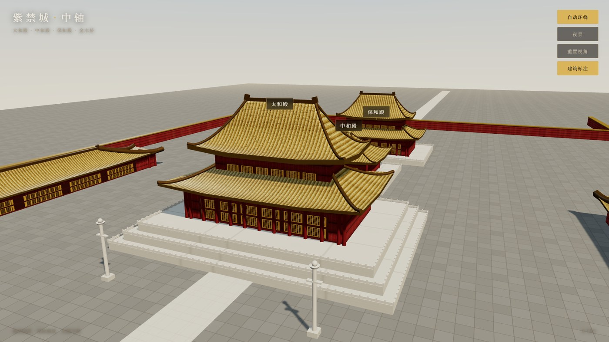
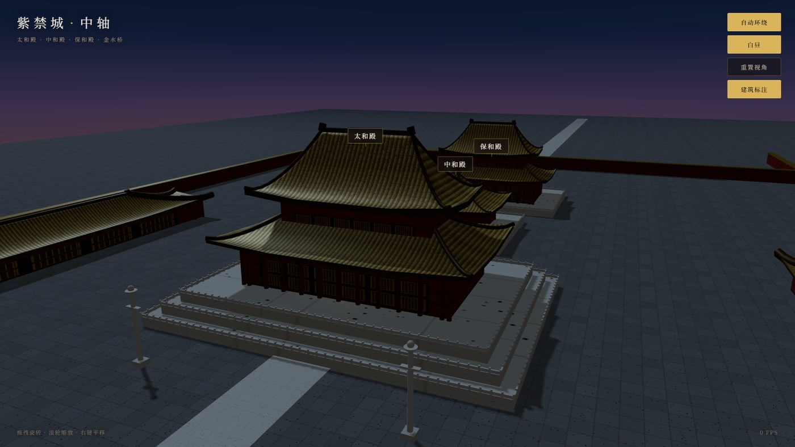

<div align="center">

# 紫禁城 · 中轴

**用 Three.js 程序化重建故宫中轴线 —— 零外部模型、零贴图资源**

[在线预览](https://wpf1022.github.io/forbidden-city-3d/) · [技术说明](#技术实现) · [MIT License](LICENSE)

</div>




## 这是什么

一个跑在浏览器里的紫禁城中轴线三维场景。太和殿、中和殿、保和殿、太和门、金水桥、午门沿南北中轴依次排开，可以自由环绕、缩放、切换昼夜。

**关键点：整个场景没有一个 `.glb` / `.obj` 模型，也没有一张 `.jpg` / `.png` 贴图。** 所有几何体由代码生成，所有纹理由 Canvas 2D 在运行时绘制。因此仓库体积只有几十 KB，克隆下来断网也能跑（首次需加载 CDN 上的 Three.js）。

## 功能

| 功能 | 说明 |
| :--- | :--- |
| 自由视角 | 拖拽旋转、滚轮缩放、右键平移（OrbitControls） |
| 自动环绕 | 缓慢自转，用于展示整体格局 |
| 昼夜切换 | 太阳位置、天空渐变、环境光、灯笼点光同步切换 |
| 建筑标注 | 各殿名称以 CSS2D 标签锚定在三维空间 |
| 响应式 | 桌面与移动端均可用 |

## 技术实现

### 一、中式屋顶的曲面：参数化高度场

这是整个项目最难也最核心的部分。

中式屋顶（庑殿顶、攒尖顶）的坡面**不是平面**，而是一条「上陡下缓」的凹曲线，且四角起翘（飞檐）。用平面多边形拼是拼不出来的，必须用曲面。

做法是定义一个高度场 `h(x, z)`。先求点到「脊」的归一化距离：

```
tz = |z| / (D/2)                        横向坡（前后坡）
tx = clamp((|x| − r) / (W/2 − r), 0, 1)  纵向坡（左右坡）
r  = (W/2) · ridgeRatio                 正脊半长
t  = max(tz, tx)
```

然后高度由凹曲线给出：

```
h(x, z) = H · (1 − t)^p        p ≈ 1.7
```

- `t = 0` 落在正脊上，`h = H`；`t = 1` 恰好落在矩形边界上，`h = 0`，也就是**檐口**。
- 当 `|x| ≤ r` 时 `tx = 0`，于是 `t` 只由 `|z|` 决定，屋顶中部就自然形成一条横向正脊 —— 这正是**庑殿顶**。
- 令 `ridgeRatio = 0`，正脊退化为一个点，`t` 在四角同时趋近 1，得到**四角攒尖顶**（中和殿用的就是这个）。
- 指数 `p > 1` 让曲线在脊处陡、在檐处缓，这就是「上陡下缓」的来源。

四角起翘单独叠加一项，只在檐口附近、且越靠近角点越强：

```
h += eaveLift · t⁸ · min(tx, tz)
```

`t⁸` 保证它只影响檐口附近，`min(tx, tz)` 保证它只在角点生效 —— 边中点处 `min(tx, tz) = 0`，不会翘。

生成方式是把一个 `PlaneGeometry` 铺在 XZ 平面上，逐顶点改写 Y 值，再 `computeVertexNormals()`。网格够密（64×44）就能得到光滑的曲面。

### 二、重檐：一个刻意的取巧

真实的重檐庑殿顶，下层檐是一圈**围合的裙檐**，中间被上层墙体截断。给高度场挖洞很麻烦。

这里的做法是：**下层檐直接用一个完整的庑殿顶，然后把上层殿身做成足够高的方体，把它整个「脊」罩住。**

结果：外面只看得到一圈裙檐，视觉上就是重檐；而省掉了一次复杂的几何裁剪。代价是上层殿身比真实比例偏高一点。这是一个明确的工程取舍，不是疏漏。

### 三、程序化纹理

所有材质都是运行时用 Canvas 2D 画的：

| 纹理 | 画法 |
| :--- | :--- |
| 琉璃瓦 | 竖向筒瓦亮暗渐变 + 横向瓦垄线 |
| 宫墙 | 红色渐变 + 竖向拍子 + 墙裙加深 |
| 汉白玉 | 石材拼缝 + 少量斑驳（**刻意不加噪点**，否则远看像脏污） |
| 广场青砖 | 网格砖块，单块明暗差压到 ±4 |
| 隔扇门窗 | 棂条格心网格 |
| 天空 | 竖向渐变，同时用作背景球与环境反射贴图 |

纹理里用了固定种子的线性同余伪随机数，保证每次刷新结果一致 —— 否则每次加载画面都不一样，调试和截图都难受。

### 四、环境光遮蔽与金属质感

琉璃瓦是有釉的，`metalness` 给到 0.22；水面到 0.5。但如果场景没有环境贴图，金属材质会渲染成**死黑**。

解决办法：把同一张天空渐变图通过 `PMREMGenerator` 转成环境反射贴图，赋给 `scene.environment`。切换昼夜时同步重建。这样瓦面和水面就能反射天空的颜色，昼夜切换时反射也跟着变。

## 本地运行

本项目是纯静态页面，**不需要构建**。但因为是 ES Module，不能直接双击 `index.html`（`file://` 协议会拦截模块加载），必须起一个本地服务器：

```bash
# Python
python -m http.server 8080

# 或 Node
npx serve .
```

然后打开 <http://localhost:8080>。

## 调试参数

URL 上可以带参数，方便截图与分享固定视角：

| 参数 | 作用 |
| :--- | :--- |
| `?view=a` | 3/4 近景，以太和殿为主体（默认） |
| `?view=b` | 正南中轴平视 |
| `?view=c` | 高空全景 |
| `?view=d` | 西侧近景 |
| `?night=1` | 直接进入夜景 |
| `?shot=1` | 关闭自动环绕，用于截图 |

组合示例：`?view=c&night=1&shot=1`

## 目录结构

```
forbidden-city-3d/
├── index.html          入口，importmap 引入 Three.js
├── css/style.css       界面样式（罗盘式 HUD）
├── js/
│   ├── main.js         场景装配、光照、昼夜、交互、渲染循环
│   ├── roof.js         屋顶高度场与几何生成（核心）
│   ├── palace.js       殿宇、台基、栏杆、华表的组合
│   ├── ground.js       广场、御道、金水河、拱桥、宫墙
│   └── textures.js     全部程序化纹理
└── docs/
    ├── preview.jpg        日景预览
    └── preview-night.jpg  夜景预览
```

## 已知局限

诚实列出，不粉饰：

1. **不是测绘级复原。** 各殿的尺寸、开间数、台基层数按公开资料的量级近似，没有逐间比对图纸。
2. **省略了大量细节。** 斗拱、脊兽、彩画、藻井、匾额都没有做。屋脊上那对「翘头」是对鸱吻的极简替代。
3. **建筑布局只覆盖中轴。** 东西六宫、文华武英殿等都没有。
4. **水面是平的。** 没有做波动、倒影和折射，只是一个高金属度、低粗糙度的反射面。
5. **重檐比例偏高**（见上文「重檐」一节的取舍说明）。

## 许可

[MIT](LICENSE) —— 随便用，注明出处即可。
